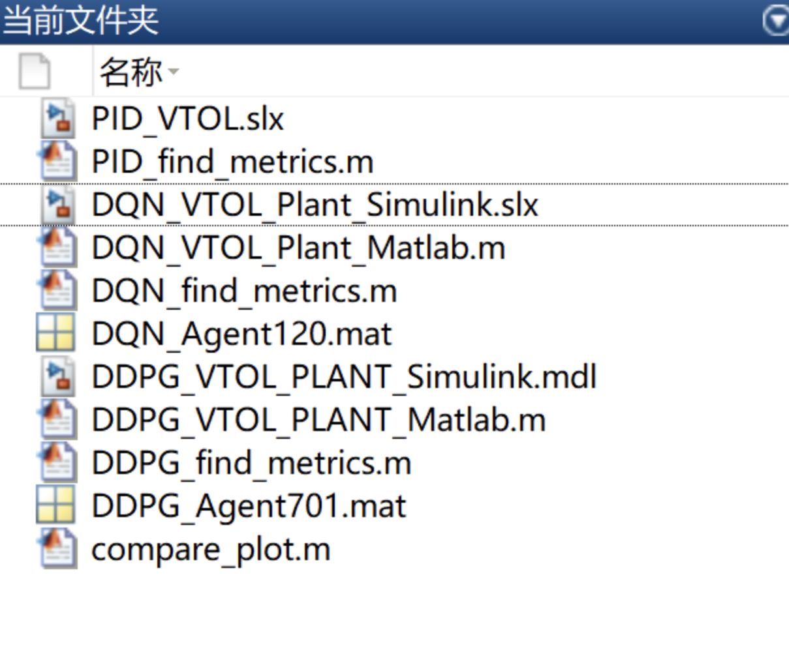

# [For VTOL DDPG DQN PD Controller]Vertical Take-off and Landing System Model Controller Design Based on Deep Reinforcement Learning Simulink, Matlab

[DDPG DQN PD Controller for VTOL]Vertical Take-Off and Landing System Model Controller Design Based on Deep Reinforcement Learning (Simulink, MATLAB Code Implementation)
Matlab version: 2021a and above
\n        \n

## Images

<!-- PAYMENT_BLOCK -->

## Get this dataset

- Payment link (Stripe): [Buy now](https://buy.stripe.com/3cs8yP7sY87d0vu9AB)
- Payment QR code: 

<!-- /PAYMENT_BLOCK -->
